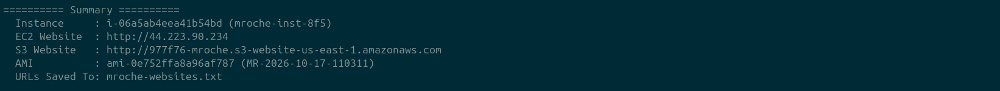
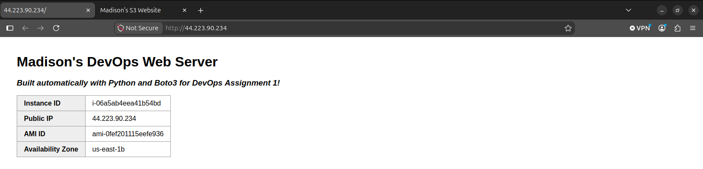
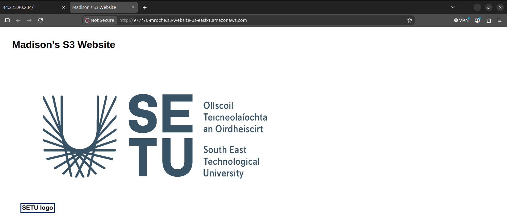
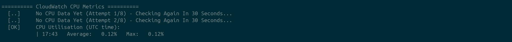
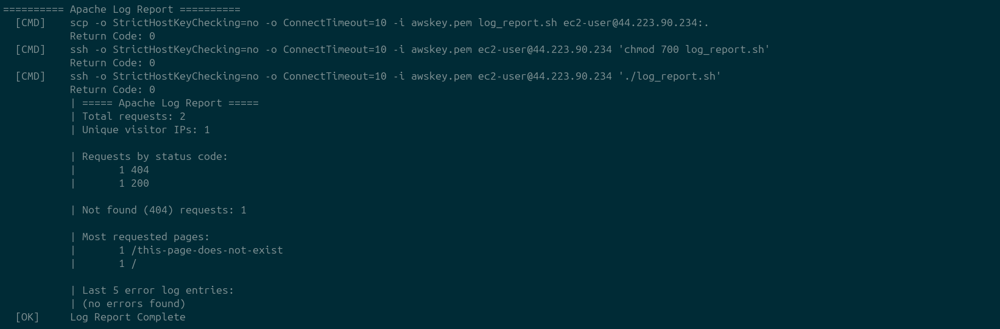
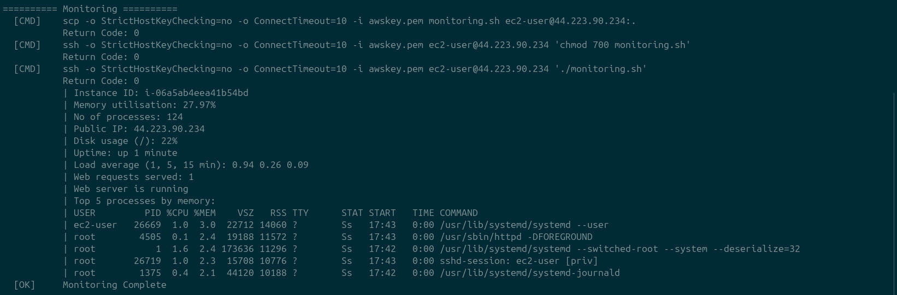
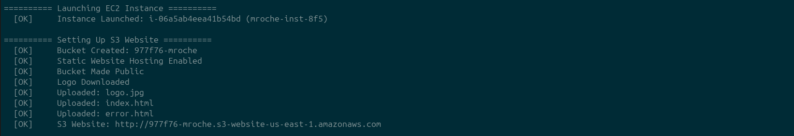
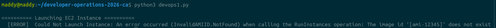

(NOTE TO MADDY: ADD IN OTHER USED REFERENCES IN SIDE DOC ON MAIN PC!!!! <br>
to finish : review code and scripts and add additional comments etc , take out links to sources ?? <br>
review this readme and make sure it is up to date with the draft version / og template created !! )

# DevOps Assignment 1 – Automated AWS Web Server Deployment

`devops1.py` is a Python 3 program that uses the Boto3 library to automate creating, launching and monitoring public-facing web servers in the Amazon cloud. A web server runs on an EC2 instance, and an S3 bucket serves static content. It runs from start to finish with no user interaction. <br> <br>
Below is a detailed account of what the program does, what features it has, processes for error handling, testing, tagging of commands, additional functionality, requirements and set up! Screenshots are included showcasing some sections output on the command line. Although more robust and detailed than the specified README.md detailed on the assignment specification, developing this README while writing the program allowed me to track what else I was required to add and to help me gain and hold an understanding of what I've built.

<!-- SCREENSHOT: the "Summary" section at the end of a successful run -->


---

## What the program does

| Step | What happens |
|---|---|
| **1. Launch EC2 instance** | Launches a `t2.nano` Amazon Linux 2023 instance in `us-east-1b` |
| **2. Instance settings** | Applies a Name tag, the `awskey` key pair and a security group allowing HTTP + SSH |
| **3. EC2 website** | User Data script patches the OS, installs Apache and builds an index page showing the instance ID, public IP, AMI ID and availability zone |
| **4. S3 website** | Creates a bucket named `<6 random chars>-mroche`, makes it public, downloads the current logo from `http://devops.setudemo.net/logo.jpg`, and uploads it with an `index.html` (and `error.html`) for static website hosting |
| **5. URLs file** | Writes both website URLs to `mroche-websites.txt` |
| **6. Monitoring** | Waits for the web server to finish setting up, then copies `monitoring.sh` to the instance with `scp` and runs it over `ssh` |
| **7. AMI creation** | Creates an AMI of the instance named `MR-<date>-<microseconds>`, e.g. `MR-2026-10-17-768875` |

The S3 website is set up while the EC2 instance is still booting, so the program isn't sitting idle waiting for EC2.

### EC2 website

<!-- SCREENSHOT: the EC2 web page in a browser, showing the metadata table -->


### S3 website

<!-- SCREENSHOT: the S3 website in a browser, showing the logo -->


---

## Additional functionality

### 1. CloudWatch CPU utilisation

After monitoring, the program uses Boto3's CloudWatch client (`get_metric_statistics`) to fetch the new instance's `CPUUtilization` metric and prints the average and maximum CPU usage for each minute.

- The instance is launched with **detailed monitoring** enabled, so metrics are reported every 1 minute instead of every 5.
- A brand-new instance can take a few minutes to appear in CloudWatch, so the program retries every 30 seconds for up to 4 minutes before moving on.
- This runs *before* the AMI is created, because creating an image reboots the instance.

<!-- SCREENSHOT: the "CloudWatch CPU Metrics" section of the terminal output -->


### 2. Apache log report

A second bash script, `log_report.sh`, is copied to the instance and run over SSH. It uses `grep`, `awk`, `sort` and `uniq` to summarise Apache's access and error logs:

- Total requests and number of unique visitor IPs
- Requests grouped by HTTP status code (200, 404, etc.)
- Number of "not found" (404) requests
- The most requested pages
- The last 5 error log entries

Before running it, the program deliberately requests a page that doesn't exist, so the report always has a 404 to show.

<!-- SCREENSHOT: the "Apache Log Report" section of the terminal output -->


### Enhanced monitoring script

`monitoring.sh` was extended beyond the provided version to also report:

- Public IP address (from the instance metadata service)
- Disk usage of the root filesystem
- Uptime
- Load average (1, 5 and 15 minutes)
- Number of web requests served (from the Apache access log)
- Top 5 processes by memory usage

<!-- SCREENSHOT: the "Monitoring" section of the terminal output -->


---

## Requirements

- **Python 3**
- **Python packages:** `boto3` and `requests` (non-standard – see install below)
- **AWS credentials** in `~/.aws/credentials` (not stored in the code)
- **An EC2 key pair** called `awskey`, with the private key file `awskey.pem` in the same folder as `devops1.py`
- **A security group** in the default VPC allowing inbound **HTTP (port 80)** and **SSH (port 22)**
- Region: **us-east-1**

---

## Setup

1. **Install the Python packages:**
   ```bash
   pip install boto3 requests
   ```
   On Ubuntu, if `pip` refuses, use:
   ```bash
   sudo apt install python3-boto3 python3-requests
   ```

2. **Add your AWS credentials** to `~/.aws/credentials`. If you're using AWS Academy, copy them from the "AWS Details" panel – they expire when the lab session ends.

3. **Put the key file in place and restrict its permissions** (ssh refuses keys that other users can read):
   ```bash
   chmod 400 awskey.pem
   ```

4. **Check the settings** at the top of `devops1.py` match your account:
   ```python
   ami_id = 'ami-0fef201115eefe936'          # current Amazon Linux 2023 AMI
   key_name = 'awskey'                       # key pair name in AWS
   key_file = 'awskey.pem'                   # key file on your computer
   security_group = 'sg-0fc7eca295775e4d3'   # security group allowing HTTP + SSH
   ```

---

## How to run

From the folder containing all the files:

```bash
python3 devops1.py
```

A full run takes around **3–6 minutes**, mostly waiting for the User Data script (OS updates and the Apache install) to finish, and for CloudWatch to report CPU data.

The terminal output is split into a heading for each stage, and every line is tagged so it's easy to follow:

| Tag | Meaning |
|---|---|
| `[OK]` | Step succeeded |
| `[..]` | Waiting / information |
| `[ERROR]` | Something went wrong – the message says what |
| `[CMD]` | A terminal command being run, followed by its return code |
| `\|` | Output that came from the instance itself |

<!-- SCREENSHOT: the start of a run, showing the first few stage headings -->


---

## Files

| File | Purpose |
|---|---|
| `devops1.py` | Main program |
| `monitoring.sh` | Monitoring script, copied to and run on the instance (Step 6) |
| `log_report.sh` | Apache log report script, copied to and run on the instance (additional functionality) |
| `mroche-websites.txt` | Created by the program – contains both website URLs |
| `logo.jpg`, `index.html`, `error.html` | Created by the program each run, then uploaded to S3 (ignored by git) |

`awskey.pem` is excluded from the repository with `.gitignore` – keys and credentials are never committed.

---

## Error handling

Each stage is its own function that catches its own errors and returns a success/failure value to `main()`, which decides whether the program should stop or carry on:

| Failure | What happens |
|---|---|
| Instance fails to launch (bad AMI, key, security group) | Error printed, program exits – nothing else can work without the instance |
| S3 bucket creation or upload fails | Error printed, program continues with the EC2 steps |
| Logo download fails (timeout, 404) | Error printed, program continues with the EC2 steps |
| Instance never reaches "running" | Error printed with a reminder to terminate the instance, program exits |
| SSH not ready yet | `scp` retried every 10 seconds, up to 10 times |
| Web server doesn't come up within 10 minutes | Error printed, monitoring and AMI skipped |
| Monitoring / log report / CloudWatch fails | Error printed, program continues to the AMI step |
| AMI creation fails | Error printed, program exits |

AWS errors are caught as `botocore.exceptions.ClientError`, waiter timeouts as `WaiterError`, web requests as `requests.exceptions.RequestException`, and file errors as `OSError`. Catching these specific types (rather than every exception) means genuine bugs in the code still show up instead of being hidden behind a friendly message.

---

## Testing

<!-- Tick off each test once you've run it, and add a screenshot if it's useful -->

| Test | How | Expected result |
|---|---|---|
| Normal run | `python3 devops1.py` | All stages `[OK]`, both websites load, AMI created |
| Invalid AMI ID | Set `ami_id = 'ami-12345'` | "Could Not Launch Instance … InvalidAMIID", exits |
| Invalid key pair | Set `key_name = 'nokey'` | "Could Not Launch Instance … InvalidKeyPair.NotFound", exits |
| Invalid security group | Set `security_group = 'sg-123'` | "Could Not Launch Instance", exits |
| Bucket name already taken | Force `bucket_name = 'aws'` | "Could Not Create Bucket … BucketAlreadyExists", EC2 steps continue |
| Invalid bucket name | Force a name with capitals | "Could Not Create Bucket … InvalidBucketName" |
| Wrong key file | Set `key_file = 'wrong.pem'` | 10 scp retries, then "Monitoring Failed - Continuing..." |
| Missing monitoring script | Rename `monitoring.sh` | "Could Not Copy monitoring.sh To Instance", program continues |
| Instance terminated while pending | Terminate in the console during launch | "Instance Did Not Reach Running State", exits |
| Exit code on failure | `echo $?` after a failed run | Prints `1` |

<!-- SCREENSHOT: an example of an error being handled, e.g. the bad AMI test -->


---

# No-AI Usage Claim
Throughout this project, there has been zero usage of any LLM's or AI models for any aspect of the project including planning, building, testing, debugging, researching, and anything else that may be included in the development of this project. All work (albeit a LOT of work) is done by real human hands and the effort has payed off! Below is a list of references and sources used to research different aspects for the project from!

## References
Most are from the course material provided, but other are listed for the additional functionality research and building.

**Course material**
- *Assignment 1 Tips* document – EC2 settings, User Data, S3 bucket policy and content types, `subprocess.run()`, scp/ssh remote execution, `instance.create_image()`

**Boto3 / AWS**
- [Boto3 – Error handling](https://docs.aws.amazon.com/boto3/latest/guide/error-handling.html)
- [Boto3 – create_instances](https://docs.aws.amazon.com/boto3/latest/reference/services/ec2/service-resource/create_instances.html)
- [Boto3 – CloudWatch get_metric_statistics](https://docs.aws.amazon.com/boto3/latest/reference/services/cloudwatch/client/get_metric_statistics.html)
- [AWS – CloudWatch metrics available for your instances](https://docs.aws.amazon.com/AWSEC2/latest/UserGuide/viewing_metrics_with_cloudwatch.html)
- [AWS – Manage detailed monitoring](https://docs.aws.amazon.com/AWSEC2/latest/UserGuide/manage-detailed-monitoring.html)
- [AWS – Run commands on your instance at launch (User Data)](http://docs.aws.amazon.com/AWSEC2/latest/UserGuide/user-data.html)

**Python**
- [requests library](https://requests.readthedocs.io)
- [Python – Sorting Techniques](https://docs.python.org/3/howto/sorting.html)
- [Python – datetime](https://docs.python.org/3/library/datetime.html)

**Apache / Linux tools**
- [Apache HTTP Server 2.4 – Log Files](https://httpd.apache.org/docs/2.4/logs.html)
- [GNU Awk User's Guide – Print Examples](https://www.gnu.org/software/gawk/manual/html_node/Print-Examples.html)
- [GNU grep manual](https://www.gnu.org/software/grep/manual/grep.html)
- [GNU Coreutils manual](https://www.gnu.org/software/coreutils/manual/coreutils.html) (sort, uniq, wc, head, tail)
